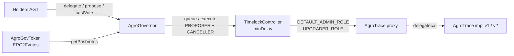
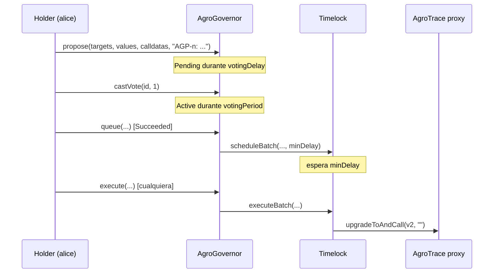

# Design Document — agro-governance

## Overview

**Purpose**: reemplazar el admin único de AgroTrace por gobernanza on-chain con demora obligatoria.
**Users**: holders de AGT (proponen y votan), cualquier cuenta (ejecuta lo aprobado), usuarios de AgroTrace
(observan propuestas y tienen tiempo para reaccionar).
**Impact**: AgroTrace no cambia su código; cambia **quién** tiene sus roles privilegiados.

### Goals
- El TimelockController es el único `DEFAULT_ADMIN_ROLE` y `UPGRADER_ROLE` de AgroTrace.
- Upgrades y cambios de roles solo vía propose → vote → queue → execute.
- Parámetros configurables por entorno, con defaults pensados para Sepolia.

### Non-Goals
- Modificar la lógica de lotes o custodia.
- Tokenomics, distribución o venta de AGT.
- Gobernanza upgradeable o cross-chain.

## Boundary Commitments

### This Spec Owns
- `AgroGovToken`, `AgroGovernor`, la configuración del `TimelockController`.
- Scripts `DeployGovernance` y `ProposeUpgrade`, y la suite `AgroGovernance.t.sol`.

### Out of Boundary
- `AgroTrace.sol` (solo se consume su interfaz `AccessControl` y `UUPS`).
- Interfaces de votación (Tally, Safe app): se documentan, no se construyen.

### Allowed Dependencies
- OpenZeppelin Contracts v5.7.0 (`governance/*`, `token/ERC20/extensions/*`).

### Revalidation Triggers
- Cambio de versión mayor de OpenZeppelin.
- Cambio en los roles de AgroTrace o en `_authorizeUpgrade`.
- Pasar el reloj del token de bloques a timestamp (ERC-6372).

## Architecture

### Existing Architecture Analysis
AgroTrace (UUPS, ERC-7201) protege `upgradeToAndCall` con `UPGRADER_ROLE` y la gestión de roles con
`DEFAULT_ADMIN_ROLE`. Basta con que esos roles los tenga el Timelock para que todo pase por la DAO.

### Architecture Pattern & Boundary Map



### Technology Stack

| Capa | Elección | Rol | Notas |
|------|----------|-----|-------|
| Token | OZ `ERC20Votes` + `ERC20Permit` | Poder de voto | Reloj por bloque |
| Governor | OZ `Governor` + 5 extensiones | Propuestas y votos | No upgradeable |
| Timelock | OZ `TimelockController` | Demora y ejecución | Auto-administrado |
| Tooling | Foundry 1.x | Build, tests, scripts | `forge script` |

## File Structure Plan

### Directory Structure
```
src/governance/
├── AgroGovToken.sol      # ERC20 + Permit + Votes, suministro fijo
└── AgroGovernor.sol      # Governor + Settings + CountingSimple + Votes + QuorumFraction + TimelockControl
script/
├── DeployGovernance.s.sol  # deploy + traspaso de roles + post-condiciones
└── ProposeUpgrade.s.sol    # propose / queue / execute de un upgrade
test/
└── AgroGovernance.t.sol    # ciclo de vida y casos de error
```

### Modified Files
- `README.md`, `.env.example` — sección de gobernanza y nuevas variables.
- `script/UpgradeAgroTrace.s.sol` — aclaración: solo sirve antes del traspaso.

## System Flows



## Requirements Traceability

| Req | Resumen | Componentes | Verificación |
|-----|---------|-------------|--------------|
| 1.1–1.5 | Token de votos | AgroGovToken | `test_Token_VotesRequireDelegation`, `test_Governor_Parameters` |
| 2.1–2.7 | Governor | AgroGovernor | `test_ProposalDefeated_*`, `test_RevertWhen_QueueBeforeVotingEnds`, `test_RevertWhen_VotingTwice`, `test_VotesAfterSnapshotDoNotCount` |
| 3.1–3.5 | Timelock | TimelockController, DeployGovernance | `test_RevertWhen_ExecuteBeforeTimelockDelay`, `test_RevertWhen_EOASchedulesOnTimelockDirectly`, `test_Handover_*` |
| 4.1–4.4 | Traspaso | DeployGovernance | `test_Handover_*`, `test_RevertWhen_FormerAdmin*`, `test_DeployScript_HandsOverEverything` |
| 5.1–5.4 | Cambios vía DAO | AgroGovernor, ProposeUpgrade | `test_Governance_*`, E2E en anvil |
| 6.1–6.4 | Parámetros y tests | DeployGovernance, suite | `test_DeployScript_HandsOverEverything` |

## Components and Interfaces

### Gobernanza

#### AgroGovToken
- `constructor(address recipient, uint256 initialSupply)` — revierte con `ZeroRecipient()`.
- Hereda `delegate`, `getVotes`, `getPastVotes`, `permit`.

#### AgroGovernor
- `constructor(IVotes token, TimelockController timelock, uint48 votingDelay, uint32 votingPeriod, uint256 proposalThreshold, uint256 quorumPercent)`.
- API estándar `IGovernor`: `propose`, `castVote`, `queue`, `execute`, `cancel`, `state`.

#### TimelockController (configuración)
- `minDelay` = `TIMELOCK_MIN_DELAY`; proposers = [] y luego `grantRole(PROPOSER_ROLE|CANCELLER_ROLE, governor)`;
  executors = [`address(0)`] (ejecución abierta); admin temporal = deployer, que renuncia al final.

### Scripts

#### DeployGovernance
- `run()` → `Deployment {agro, token, timelock, governor}`; `loadConfig(deployer)` lee el entorno.
- Revierte con `DeployerIsNotAgroAdmin` o `HandoverFailed(string)`.

#### ProposeUpgrade
- `run()` (propose), `queue()`, `execute()`; la propuesta es `[proxy.upgradeToAndCall(NEW_IMPLEMENTATION, "")]`.

## Data Models

### Domain Model
- **Propuesta** = (targets, values, calldatas, keccak256(descripción)) → `proposalId` (hash). Estados:
  Pending → Active → Succeeded/Defeated → Queued → Executed (o Canceled/Expired).

### Physical Data Model
- No se agrega storage a AgroTrace. El token y el Governor usan su propio storage (no son proxies).

## Error Handling

### Error Strategy
Se reutilizan los errores de OpenZeppelin: `AccessControlUnauthorizedAccount`,
`GovernorUnexpectedProposalState`, `GovernorAlreadyCastVote`, `TimelockUnexpectedOperationState`.
Errores propios solo donde aportan contexto: `ZeroRecipient`, `DeployerIsNotAgroAdmin`, `HandoverFailed`.

### Monitoring
Eventos estándar (`ProposalCreated`, `VoteCast`, `ProposalQueued`, `ProposalExecuted`, `CallScheduled`,
`CallExecuted`, `RoleGranted`, `RoleRevoked`, `Upgraded`) indexables por Tally o un subgraph.

## Testing Strategy

- **Unit**: parámetros, delegación, traspaso de roles, rechazos de llamadas directas.
- **Integración**: ciclo completo con upgrade a `AgroTraceV2Mock` + `setNote` en la misma propuesta;
  alta y baja de productores vía DAO.
- **Casos de error**: sin quórum, mayoría en contra, queue antes de tiempo, execute antes de la demora,
  doble voto, votos posteriores al snapshot.
- **Script**: `DeployGovernance.run()` ejecutado dentro de un test con variables de entorno.
- **E2E manual**: anvil + `DeployGovernance` + `ProposeUpgrade` (propose/queue/execute) con `cast`.

## Optional Sections

### Security Considerations
- **Ataque de gobernanza / flash loans**: el voto se mide en el snapshot (bloque pasado), no en el actual.
- **Quórum bajo (4%)**: adecuado para pruebas; en mainnet evaluar 10%+ y un `proposalThreshold` > 0.
- **Concentración del token**: con suministro fijo en el deployer, la DAO es en la práctica una wallet
  hasta que se distribuya AGT. Alternativa: Safe multisig como proposer (ver README).
- **Ejecución abierta**: segura porque solo se ejecuta lo que ya pasó votación y demora.
- **Proxy reutilizado**: si `PROXY_ADDRESS` tenía otros admins además del deployer, hay que revocarlos con
  una propuesta (AccessControl no es enumerable, el script no puede detectarlos).

### Migration Strategy
1. Deploy de AgroTrace (o reutilizar el proxy existente).
2. `DeployGovernance` hace el traspaso en un solo broadcast.
3. Desde ese momento `UpgradeAgroTrace.s.sol` deja de servir; los upgrades usan `ProposeUpgrade.s.sol`.
