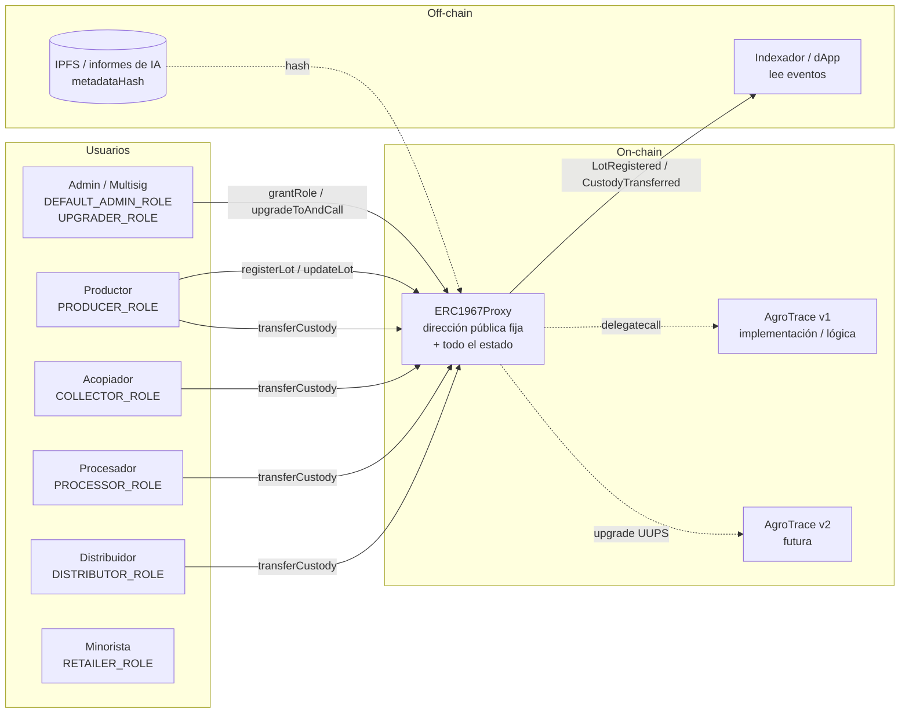
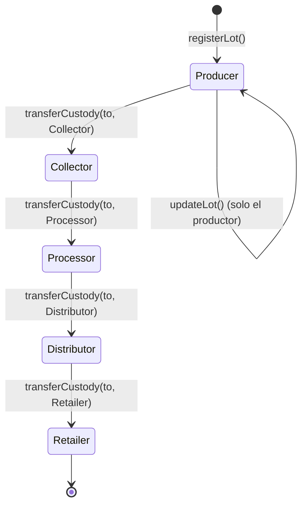

# AgroTrace 🌾 — Trazabilidad agrícola on-chain

Proyecto final del **Máster en Blockchain + IA** — Hernán Figueroa (Buenos Aires, Argentina).

Contrato inteligente en Solidity para Ethereum que registra **lotes agrícolas** (productor, ubicación GPS,
fecha de cosecha, cultivo, certificaciones) y la **cadena de custodia** de cada lote:

```
Productor → Acopiador → Procesador → Distribuidor → Minorista
```

Hecho con **Foundry** y **OpenZeppelin Contracts Upgradeable v5** (proxy **UUPS** + storage **ERC-7201**).

> Es un esqueleto pensado para clonar, entender, completar y probar. Prioriza claridad y buenas prácticas
> por sobre funcionalidad extra.

---

## Índice

1. [Estructura del proyecto](#estructura-del-proyecto)
2. [Arquitectura](#arquitectura)
3. [Modelo de datos y roles](#modelo-de-datos-y-roles)
4. [Decisiones de diseño](#decisiones-de-diseño)
5. [Instalación](#instalación)
6. [Tests y gas report](#tests-y-gas-report)
7. [Deploy en Sepolia y verificación en Etherscan](#deploy-en-sepolia-y-verificación-en-etherscan)
8. [Upgrades](#upgrades)
9. [Interacción con ethers.js (opcional)](#interacción-con-ethersjs-opcional)
10. [Próximos pasos (ruta de práctica)](#próximos-pasos-ruta-de-práctica)

---

## Estructura del proyecto

```
agro-trace/
├── src/
│   └── AgroTrace.sol              # Contrato principal (implementación UUPS)
├── test/
│   ├── AgroTrace.t.sol            # Tests Foundry (39 tests: happy path, accesos, edge cases, upgrades)
│   └── mocks/
│       └── AgroTraceV2Mock.sol    # V2 de ejemplo para probar que el upgrade preserva el estado
├── script/
│   ├── DeployAgroTrace.s.sol      # Despliega implementación + ERC1967Proxy (Sepolia)
│   └── UpgradeAgroTrace.s.sol     # Despliega nueva implementación y hace upgradeToAndCall
├── examples/
│   ├── interact.mjs               # Ejemplo mínimo con ethers.js v6
│   └── package.json
├── .github/workflows/test.yml     # CI: fmt + build + test en cada push (GitHub Actions)
├── foundry.toml                   # Compilador, optimizer, RPC y Etherscan
├── remappings.txt
├── .env.example                   # SEPOLIA_RPC_URL, PRIVATE_KEY, ETHERSCAN_API_KEY
└── README.md
```

`lib/` (dependencias), `out/` y `cache/` **no se incluyen**: se regeneran con `forge install` y `forge build`.

---

## Arquitectura



Ciclo de vida de un lote:



- **Proxy (ERC1967Proxy)**: la dirección que usan todos. Guarda el estado y delega (`delegatecall`) la lógica.
- **Implementación (AgroTrace)**: solo lógica. Se puede reemplazar con un upgrade UUPS sin cambiar la dirección
  ni perder datos.
- **Eventos**: son el "libro de historia" del lote. El storage guarda solo el **estado actual**
  (custodio y etapa); el historial completo se reconstruye leyendo `CustodyTransferred`.

---

## Modelo de datos y roles

### Struct `Lot` (4 slots de storage)

| Slot | Campos | Bytes |
|------|--------|-------|
| 0 | `address producer` · `uint64 harvestDate` · `uint16 certifications` · `Stage stage` | 20+8+2+1 = 31 |
| 1 | `address custodian` · `int32 latitude` · `int32 longitude` | 20+4+4 = 28 |
| 2 | `bytes32 cropType` | 32 |
| 3 | `bytes32 metadataHash` | 32 |

- **Coordenadas**: grados × 1e6 en `int32` (precisión ~11 cm). Ej.: Pergamino `-33.889444, -60.573611`
  → `-33889444, -60573611`. Se validan rangos (±90° / ±180°).
- **Cultivo**: `bytes32`, ej. `bytes32("SOJA")` / `ethers.encodeBytes32String("SOJA")`.
- **Certificaciones**: bitmask `uint16`.

| Constante | Bit | Valor |
|-----------|-----|-------|
| `CERT_ORGANIC` | 0 | 1 |
| `CERT_FAIR_TRADE` | 1 | 2 |
| `CERT_GLOBAL_GAP` | 2 | 4 |
| `CERT_RAINFOREST` | 3 | 8 |
| `CERT_NON_GMO` | 4 | 16 |

  Se combinan con OR (`1 | 16` = orgánico + no OGM). Bits fuera de `CERT_MASK` se rechazan.
- **metadataHash**: hash de datos off-chain (fotos, análisis de suelo, informe generado por IA en IPFS).
  Es el punto de unión natural con la parte de **IA** del máster.

### Roles (AccessControl)

| Rol | Puede |
|-----|-------|
| `DEFAULT_ADMIN_ROLE` | Otorgar/revocar todos los roles |
| `UPGRADER_ROLE` | Autorizar upgrades (`upgradeToAndCall`) |
| `PRODUCER_ROLE` | `registerLot`; `updateLot` solo de **sus** lotes y **antes** de la primera transferencia |
| `COLLECTOR_ROLE` / `PROCESSOR_ROLE` / `DISTRIBUTOR_ROLE` / `RETAILER_ROLE` | Recibir el lote en esa etapa |

**Transferencias**: solo el **custodio actual** llama a `transferCustody(lotId, to, nextStage)`.
`nextStage` tiene que ser exactamente la etapa siguiente (no se saltean, no se retrocede, no se pasa de
Minorista) y `to` tiene que tener el rol de esa etapa.

---

## Decisiones de diseño

1. **UUPS en vez de Transparent Proxy**: la lógica de upgrade vive en la implementación, el proxy es más
   barato en cada llamada y `_authorizeUpgrade` queda restringido a `UPGRADER_ROLE`.
   Riesgo conocido: si se sube una implementación sin `upgradeToAndCall`, el proxy queda congelado. OZ lo
   mitiga chequeando `proxiableUUID()` (hay un test para eso).
2. **`_disableInitializers()` en el constructor**: nadie puede inicializar (ni tomar control de) la
   implementación directamente.
3. **Inicialización atómica**: el script pasa `initialize(admin)` como `data` del constructor del proxy, así
   no hay ventana para que alguien haga front-running del `initialize`.
4. **Storage ERC-7201 (namespaced)** en vez de `__gap`: el estado vive en un slot derivado de
   `agrotrace.storage.AgroTrace`, igual que hace OpenZeppelin v5 internamente. Las versiones nuevas pueden
   agregar su propio namespace (ver `AgroTraceV2Mock`) sin riesgo de colisión. Regla de oro: en el struct
   `Lot` solo se **agregan campos al final**, nunca se reordenan ni se borran.
5. **Packing de storage**: 9 campos en 4 slots. `registerLot` paga 4 SSTORE en frío en vez de 9.
6. **Custom errors** en vez de revert strings: más baratos en deploy y en runtime, y llevan parámetros útiles
   para debuggear (`NotCustodian(lotId, caller)`, `InvalidStageTransition(current, requested)`).
7. **`calldata`**: `registerLot(LotInput calldata)` lee los parámetros sin copiarlos a memoria.
8. **Eventos como historial**: no se guarda un array de transferencias en storage (caro y crece sin límite);
   se emiten eventos con `lotId`, `from` y `to` indexados para filtrarlos fácil desde una dApp o un indexador
   (The Graph, Ponder, etc.).
9. **Etapa explícita en `transferCustody`**: aunque se podría deducir, pedir `nextStage` hace explícita la
   intención del que llama y vuelve el error más claro.
10. **Datos congelados después de la primera transferencia**: el productor no puede "reescribir" la historia
    una vez que el lote salió de su custodia.
11. **Ids desde 1**: `lotId == 0` nunca existe; `producer == address(0)` marca un lote inexistente.
12. **Fuera de alcance (a propósito)**: pausa de emergencia, división/fusión de lotes, oráculos, NFTs por lote.
    Son buenas extensiones para una V2.

---

## Instalación

Requisitos: [Foundry](https://getfoundry.sh) y git.

```bash
# 1) Instalar Foundry (si no lo tenés)
curl -L https://foundry.paradigm.xyz | bash
foundryup

# 2) Descomprimir el zip e inicializar git (forge install usa submódulos de git)
cd agro-trace
git init

# 3) Instalar dependencias en lib/ (crea .gitmodules y foundry.lock)
forge install foundry-rs/forge-std@v1.17.0 \
  OpenZeppelin/openzeppelin-contracts@v5.7.0 \
  OpenZeppelin/openzeppelin-contracts-upgradeable@v5.7.0

# 4) Compilar
forge build
```

Si en cambio clonás un repo que ya tiene los submódulos (por ejemplo, después de subirlo a tu GitHub), alcanza
con `git clone --recursive <url>` o con `forge install` sin argumentos dentro del repo.

Versiones probadas: Foundry 1.10.0, solc 0.8.28, OpenZeppelin 5.7.0, forge-std 1.17.0.

> `foundry.toml` usa `auto_detect_remappings = false` y `remappings.txt` explícito, para que las dos librerías
> de OpenZeppelin usen **la misma** copia de `@openzeppelin/contracts` (evita errores de tipos duplicados).

---

## Tests y gas report

```bash
forge test                 # corre todos los tests
forge test -vvv            # con trazas de los que fallan
forge test --match-test test_Upgrade_PreservesState -vvvv
forge test --gas-report    # costo de gas por función
forge snapshot             # guarda .gas-snapshot para comparar optimizaciones
forge coverage             # cobertura
forge fmt                  # formateo
forge inspect AgroTrace storageLayout   # layout de storage (clave para upgrades)
FOUNDRY_PROFILE=ci forge test           # fuzzing con 5000 corridas
```

Cobertura de los 39 tests (`test/AgroTrace.t.sol`):

- **Camino feliz**: registro con todos los datos y evento, ids incrementales, cadena completa
  productor→minorista con un evento por traspaso, `updateLot`.
- **Acceso no autorizado**: registrar/actualizar sin rol, actualizar lote ajeno, rol revocado, transferir sin
  ser custodio (incluido el custodio anterior), upgrade por cuenta sin `UPGRADER_ROLE`.
- **Edge cases**: coordenadas fuera de rango y en el límite exacto, fecha de cosecha 0 o futura, cultivo
  vacío, bits de certificación desconocidos, saltear/retroceder/repetir etapa, transferir después de
  Minorista, valor de enum inválido, destinatario sin rol o con rol de otra etapa, `address(0)`,
  lote inexistente, doble `initialize`, `initialize` sobre la implementación, admin cero, upgrade a un
  contrato no UUPS.
- **Upgrades**: V1 → `AgroTraceV2Mock` conserva lotes, roles y dirección; la lógica vieja sigue andando y la
  nueva (con su propio namespace ERC-7201) también.
- **Packing**: test que verifica con `vm.load` que un lote ocupa exactamente 4 slots.
- **Fuzzing**: coordenadas válidas aleatorias.

### Referencia de gas (medido en anvil, tx completa vía proxy)

| Operación | Gas aprox. |
|-----------|-----------:|
| Deploy implementación + proxy + initialize | ~1.94 M |
| `registerLot` (primer lote, con `metadataHash`) | ~148 k |
| `registerLot` (sin `metadataHash`) | ~108 k |
| `transferCustody` | ~43 k |
| `grantRole` | ~57 k |

Tamaño del runtime: ~7.2 KB (muy lejos del límite de 24 KB).
Los números de `forge test --gas-report` son menores porque miden solo la ejecución interna (sin los 21 k de
base de la tx y con slots "tibios" dentro del mismo test).

---

## Deploy en Sepolia y verificación en Etherscan

### 1. Configurar variables

```bash
cp .env.example .env
# editá .env: SEPOLIA_RPC_URL, PRIVATE_KEY (wallet de PRUEBA con ETH de Sepolia), ETHERSCAN_API_KEY
source .env
```

`foundry.toml` ya define el alias `sepolia` para `--rpc-url` y para la verificación en Etherscan.

> 🔐 Nunca uses tu clave de mainnet acá. Mejor todavía: importala al keystore cifrado de Foundry con
> `cast wallet import dev --interactive` y usá `--account dev` en lugar de `--private-key`.

### 2. Opción A (recomendada): `forge script`

Despliega la implementación y el proxy (inicializado en la misma tx) y verifica ambos:

```bash
# Simulación (no gasta nada)
forge script script/DeployAgroTrace.s.sol:DeployAgroTrace --rpc-url sepolia -vvvv

# Deploy real + verificación
forge script script/DeployAgroTrace.s.sol:DeployAgroTrace --rpc-url sepolia --broadcast --verify -vvvv
```

La consola muestra la dirección de la **implementación** y la del **proxy** (la que usás siempre).

### 3. Opción B: `forge create` (paso a paso)

```bash
# 3.1 Implementación
forge create src/AgroTrace.sol:AgroTrace \
  --rpc-url sepolia --private-key $PRIVATE_KEY --broadcast --verify
export IMPL=0x...   # "Deployed to" del paso anterior

# 3.2 Calldata de initialize(admin)
export ADMIN=$(cast wallet address --private-key $PRIVATE_KEY)
export INIT_DATA=$(cast calldata "initialize(address)" $ADMIN)

# 3.3 Proxy apuntando a la implementación, inicializado en el constructor
forge create lib/openzeppelin-contracts/contracts/proxy/ERC1967/ERC1967Proxy.sol:ERC1967Proxy \
  --rpc-url sepolia --private-key $PRIVATE_KEY --broadcast \
  --constructor-args $IMPL $INIT_DATA
export PROXY=0x...
```

### 4. Verificación manual (si `--verify` falló o usaste la opción B sin verificar)

```bash
# Implementación
forge verify-contract $IMPL src/AgroTrace.sol:AgroTrace --chain sepolia --watch

# Proxy (con los argumentos del constructor ABI-encodeados)
forge verify-contract $PROXY \
  lib/openzeppelin-contracts/contracts/proxy/ERC1967/ERC1967Proxy.sol:ERC1967Proxy \
  --chain sepolia --watch \
  --constructor-args $(cast abi-encode "constructor(address,bytes)" $IMPL $INIT_DATA)
```

Después, en Etherscan, en la página del proxy: **Contract → More Options → Is this a proxy? → Verify**.
Así aparecen las pestañas **Read as Proxy / Write as Proxy** con la ABI de AgroTrace.

### 5. Primeras interacciones con `cast`

```bash
# Dar rol de productor
cast send $PROXY "grantRole(bytes32,address)" $(cast keccak PRODUCER_ROLE) $ADMIN \
  --rpc-url sepolia --private-key $PRIVATE_KEY

# Registrar un lote: (lat, lon, harvestDate, cropType, certifications, metadataHash)
cast send $PROXY "registerLot((int32,int32,uint64,bytes32,uint16,bytes32))" \
  "(-33889444,-60573611,1740000000,$(cast format-bytes32-string SOJA),17,$(cast keccak informe-ia))" \
  --rpc-url sepolia --private-key $PRIVATE_KEY

# Leer el lote 1
cast call $PROXY "getLot(uint256)((address,uint64,uint16,uint8,address,int32,int32,bytes32,bytes32))" 1 \
  --rpc-url sepolia
```

---

## Upgrades

1. Creá `src/AgroTraceV2.sol` heredando de `AgroTrace` (o copiándolo) y respetando el layout de storage.
   Usá `test/mocks/AgroTraceV2Mock.sol` como modelo.
2. Escribí un test como `test_Upgrade_PreservesState` para la V2 real.
3. Compará layouts: `forge inspect AgroTrace storageLayout` vs. `forge inspect AgroTraceV2 storageLayout`.
   Para validación automática, sumá
   [openzeppelin-foundry-upgrades](https://github.com/OpenZeppelin/openzeppelin-foundry-upgrades)
   (`Upgrades.validateUpgrade`).
4. Editá `script/UpgradeAgroTrace.s.sol` para desplegar la V2 y corré:

```bash
PROXY_ADDRESS=0x... forge script script/UpgradeAgroTrace.s.sol:UpgradeAgroTrace \
  --rpc-url sepolia --broadcast --verify -vvvv
```

---

## Interacción con ethers.js (opcional)

`examples/interact.mjs` registra un lote, lo lee y consulta el historial de custodia desde los eventos.

```bash
# Local con anvil
anvil   # en otra terminal
PRIVATE_KEY=0xac0974bec39a17e36ba4a6b4d238ff944bacb478cbed5efcae784d7bf4f2ff80 \
  forge script script/DeployAgroTrace.s.sol:DeployAgroTrace --rpc-url http://127.0.0.1:8545 --broadcast

cd examples && npm install
RPC_URL=http://127.0.0.1:8545 \
PRIVATE_KEY=0xac0974bec39a17e36ba4a6b4d238ff944bacb478cbed5efcae784d7bf4f2ff80 \
PROXY_ADDRESS=0xe7f1725E7734CE288F8367e1Bb143E90bb3F0512 \
node interact.mjs
```

(La clave de arriba es la cuenta #0 pública de anvil: **solo para local**.)
Para Sepolia, usá `RPC_URL=$SEPOLIA_RPC_URL` y la dirección del proxy desplegado.

Fragmento clave:

```js
const tx = await agro.registerLot({
  latitude: Math.round(-33.889444 * 1e6),
  longitude: Math.round(-60.573611 * 1e6),
  harvestDate: Math.floor(Date.UTC(2025, 2, 15) / 1000),
  cropType: ethers.encodeBytes32String("SOJA"),
  certifications: 1 | 16, // orgánico + no OGM
  metadataHash: ethers.id("ipfs://bafy...informe-ia"),
});
await tx.wait();
const history = await agro.queryFilter(agro.filters.CustodyTransferred(lotId), 0);
```

---

## Próximos pasos (ruta de práctica)

Alineados con `ruta-practica-ethereum.md` de
[hernick/blockchain-mainnet-practice](https://github.com/hernick/blockchain-mainnet-practice):

1. **Foundry local** — `forge build`, `forge test -vvv`, levantar `anvil` y desplegar con el script contra
   `http://127.0.0.1:8545`. Jugar con `cast` para registrar y transferir lotes.
2. **Sepolia testnet** — deploy con `forge script ... --broadcast --verify`, verificar el proxy en Etherscan y
   recorrer la cadena completa con 5 wallets distintas (una por rol).
3. **Interacción con ethers.js** — partir de `examples/interact.mjs`; armar una mini dApp que muestre el
   historial de un lote (por ejemplo, leyendo un QR con el `lotId`).
4. **Mainnet con montos chicos** — usar una **multisig (Safe)** como admin y `UPGRADER_ROLE`, keystore cifrado
   en vez de `PRIVATE_KEY` en `.env`, y simular primero con `--fork-url`. Costo de referencia: ~1.94 M gas
   de deploy.
5. **Auditoría estilo Code4rena** — correr `slither .` y `aderyn`, escribir tests de invariantes
   (ej.: "la etapa nunca retrocede", "el custodio siempre tiene el rol de su etapa"), revisar los riesgos de
   UUPS y de centralización del admin, y documentar hallazgos con el formato de severidades de C4.
6. **Optimización de gas** — `forge snapshot` como línea base y comparar con `forge snapshot --diff`. Ideas:
   empaquetar `cropType` como `bytes16`, emitir menos datos en los eventos, `registerLots` en batch con
   `calldata`, probar `via_ir = true`.

Ideas para la parte de **IA**: guardar en `metadataHash` el hash de un informe generado por un modelo
(detección de plagas en fotos, predicción de rinde, scoring de riesgo del productor) y que una V2 agregue un
`ORACLE_ROLE` que publique ese resultado on-chain.

---

## Licencia

MIT
