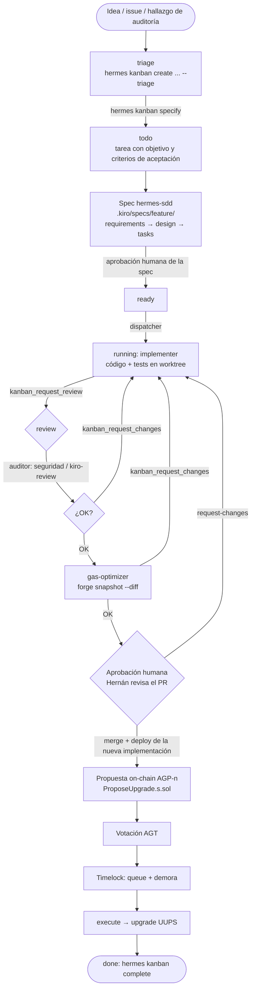

# Gobernanza del proceso con Hermes Kanban + hermes-sdd

Este documento describe **cómo se decide, especifica, implementa y revisa** cada cambio de AgroTrace antes
de que llegue a la gobernanza on-chain. Une dos herramientas:

- **[hermes-sdd](https://github.com/BarryYin/Hermes-sdd)**: skills de spec-driven development (adaptadas de
  [cc-sdd](https://github.com/gotalab/cc-sdd)) que generan `.kiro/steering/` y
  `.kiro/specs/<feature>/{requirements,design,tasks}.md`.
- **[Hermes Kanban](https://hermes-agent.nousresearch.com/docs/user-guide/features/kanban)**: un tablero
  persistente (`~/.hermes/kanban.db`) donde varios perfiles de Hermes (agentes con identidad propia) toman
  tareas, se pasan el trabajo y piden revisiones.

> **Alcance**: esto es gobernanza del **proceso de desarrollo** (off-chain). La gobernanza **del contrato**
> (on-chain) es AgroGovernor + Timelock (ver README). El puente entre las dos es el paso final: una
> propuesta `AGP-n` en el Governor.
>
> Hermes **no** se instala en este repo. Los comandos están verificados contra la documentación oficial
> de Kanban (consultada el 24/11/2026); lo marcado **(no verificado)** son supuestos a confirmar con
> `hermes --help` en tu instalación.

---

## 1. Flujo completo



Estados de una tarjeta según la documentación: `triage`, `todo`, `ready`, `running`, `blocked`, `review`,
`done` (y `archived`).

---

## 2. Perfiles (workers)

Cada worker es un **perfil** de Hermes con su modelo, skills y memoria. El decomposer y el dispatcher los
eligen por nombre y por descripción.

| Perfil | Responsabilidad | Skills sugeridas |
|--------|-----------------|------------------|
| `implementer` | Escribe contratos, tests y scripts según `tasks.md`; corre `forge fmt`, `forge build` y `forge test`. | `kiro-impl`, `kiro-validate-impl` |
| `auditor` | Revisa seguridad: control de acceso, layout de storage UUPS, reentrancy, riesgos de gobernanza; corre `slither`/`aderyn` si están. | `kiro-review`, `kiro-validate-design` |
| `gas-optimizer` | Compara `forge snapshot --diff` y `forge build --sizes`, propone optimizaciones sin cambiar comportamiento. | `kiro-review` |
| `orchestrator` (opcional) | Solo opera el tablero (crear, enlazar, desbloquear); no toca código. | toolset `kanban` |

Crear los perfiles con descripción (la doc muestra `hermes profile create --description "..."`; la forma
exacta del argumento con el nombre está **(no verificado)**):

```bash
hermes profile create implementer --description "Implementa contratos Solidity/Foundry de AgroTrace siguiendo .kiro/specs" # (no verificado: posición del nombre)
hermes profile create auditor --description "Audita seguridad de contratos UUPS y gobernanza OpenZeppelin"            # (no verificado)
hermes profile create gas-optimizer --description "Optimiza gas con forge snapshot sin cambiar comportamiento"           # (no verificado)

# Instalar las skills de hermes-sdd (según su README)
npx hermes-sdd@latest            # instala las skills kiro-* en ~/.hermes/skills/kiro-sdd/
hermes skills list               # comprobar que el perfil las ve

# Dar el toolset de kanban a un perfil orquestador (comando de la doc)
hermes -p orchestrator tools enable kanban
```

---

## 3. Paso a paso con comandos

### 3.1 Preparar el tablero (una vez)

```bash
hermes kanban init        # crea ~/.hermes/kanban.db
hermes gateway start      # el gateway aloja el dispatcher (toma tareas `ready` cada 60 s por defecto)
hermes dashboard          # opcional: pestaña "Kanban" con las columnas
```

Para que **ningún** agente arranque trabajo sin que un humano lo mire, usar modo manual de orquestación en
`~/.hermes/config.yaml`:

```yaml
kanban:
  auto_decompose: false   # las tareas quedan en triage hasta que alguien las especifique/descomponga
  review_dispatch: true   # el dispatcher lanza al revisor asignado; con false, la revisión es solo humana
```

### 3.2 Triage → specify → todo

```bash
# Idea cruda: queda en la columna triage
hermes kanban create "Gobernanza on-chain: Governor + Timelock como admin de AgroTrace" --triage

# Hermes reescribe la tarjeta con objetivo, contexto y criterios de aceptación y la pasa a todo
hermes kanban specify t_gov1

hermes kanban show t_gov1
```

Alternativa con fan-out automático en subtareas: `hermes kanban decompose t_gov1`.

### 3.3 Spec con hermes-sdd (dentro del repo)

En una sesión de Hermes sobre el repo se cargan las skills en orden (los nombres son los de hermes-sdd):

```
kiro-steering                     -> .kiro/steering/{product,tech,structure}.md
kiro-spec-init agro-governance    -> .kiro/specs/agro-governance/spec.json
kiro-spec-requirements            -> requirements.md (EARS)
kiro-validate-gap / kiro-spec-design / kiro-validate-design -> design.md
kiro-spec-tasks                   -> tasks.md (con _Requirements:_ y marcas (P))
```

El resultado de este proyecto ya está versionado en `.kiro/`. **Gate humano**: Hernán aprueba
requirements, design y tasks (en `spec.json`, `approvals.*.approved = true`) antes de pasar a `ready`.

### 3.4 Implementación

```bash
hermes kanban create "Implementar tasks 1-2 de agro-governance" \
  --assignee implementer \
  --parent t_gov1 \
  --workspace worktree --branch agro-trace-uups \
  --skill kiro-impl \
  --body "Seguir .kiro/specs/agro-governance/tasks.md. Criterio: forge fmt --check, forge build y forge test en verde."
```

El worker lee su tarjeta con `kanban_show()`, implementa y, al terminar, **no** cierra la tarea: llama
`kanban_request_review(summary=..., metadata=...)` y la tarjeta pasa a `review`. Metadata sugerida
(formato recomendado por la doc):

```json
{"changed_files": ["src/governance/AgroGovernor.sol", "test/AgroGovernance.t.sol"],
 "tests_run": ["forge test: 56 passed"],
 "decisions": ["Governor no upgradeable", "ejecución abierta en el Timelock"],
 "residual_risk": ["quórum 4% solo apto para testnet"]}
```

### 3.5 Revisiones: auditor y gas-optimizer

```bash
# Desde la CLI (o el worker con la tool kanban_request_review) se asigna revisor
hermes kanban request-review t_impl --summary "Governor + Timelock listos, 56 tests" --reviewer auditor

# Si el auditor encuentra un problema, devuelve la tarjeta al implementer
hermes kanban request-changes t_impl "El script no verifica que el deployer renunció al admin del Timelock"

# Tarea de gas encadenada a la implementación (hereda su handoff por el link de parent)
hermes kanban create "Revisión de gas de agro-governance" \
  --assignee gas-optimizer --parent t_impl \
  --body "Comparar forge snapshot --diff contra main. No cambiar comportamiento."

hermes kanban comment t_impl "Auditoría OK: roles verificados, sin admin residual"
hermes kanban tail t_impl          # seguir los eventos de una tarjeta
hermes kanban watch                # todos los eventos del tablero
```

Los workers usan las tools equivalentes: `kanban_request_review`, `kanban_request_changes`,
`kanban_comment`, `kanban_complete`, `kanban_block`.

### 3.6 Aprobación humana

La doc de Kanban aclara que los *governance gates* quedan en espacio de usuario: el tablero no los impone
solo. En este proyecto la regla es:

1. Hernán revisa el PR (diff, `forge test`, informe del auditor y del gas-optimizer).
2. Si no está conforme: `hermes kanban request-changes t_impl "..."`.
3. Si está conforme: merge y `hermes kanban complete t_impl --result "Aprobado por Hernán; ver PR #N"`.

### 3.7 Del tablero a la cadena

Con el código aprobado, el cambio todavía **no** está en producción: la implementación nueva se despliega
y se propone a la DAO.

```bash
hermes kanban create "AGP-1: proponer upgrade a v2" --assignee implementer --parent t_impl \
  --body "Correr script/ProposeUpgrade.s.sol en Sepolia y adjuntar proposalId."

# Lo que ejecuta esa tarea (o un humano):
forge script script/ProposeUpgrade.s.sol:ProposeUpgrade --rpc-url sepolia --broadcast
cast send $GOVERNOR_ADDRESS "castVote(uint256,uint8)" <proposalId> 1 --rpc-url sepolia --private-key $PRIVATE_KEY
NEW_IMPLEMENTATION=0x... forge script script/ProposeUpgrade.s.sol:ProposeUpgrade --sig "queue()" --rpc-url sepolia --broadcast
NEW_IMPLEMENTATION=0x... forge script script/ProposeUpgrade.s.sol:ProposeUpgrade --sig "execute()" --rpc-url sepolia --broadcast
```

Mientras la votación y el timelock corren, la tarjeta puede quedar bloqueada esperando:
`hermes kanban block t_agp1 "Esperando fin de votación (bloque N) y demora del timelock"` y luego
`hermes kanban unblock t_agp1`. Al ejecutarse: `hermes kanban complete t_agp1 --result "AGP-1 ejecutada, tx 0x..."`.

---

## 4. Trazabilidad de punta a punta

| Evidencia | Dónde queda |
|-----------|-------------|
| Por qué se hizo el cambio | Tarjeta de triage + `requirements.md` |
| Cómo se diseñó | `design.md` (con trazabilidad requisito → test) |
| Quién lo implementó y revisó | Historial de la tarjeta (`hermes kanban runs`, comentarios, review) |
| Aprobación humana | Comentario/`complete` en Kanban + merge del PR |
| Aprobación de la comunidad | `ProposalCreated` / `VoteCast` en el Governor |
| Ejecución | `CallExecuted` del Timelock + `Upgraded` del proxy |

Así el proyecto aplica la misma idea de trazabilidad que da a los lotes agrícolas, pero al propio software.

---

## 5. Referencia de comandos usados

Verificados contra la referencia CLI de la doc de Kanban: `init`, `create` (`--body`, `--assignee`,
`--parent`, `--workspace`, `--branch`, `--triage`, `--skill`), `specify`, `decompose`, `show`, `list`,
`comment`, `request-review` (`--summary`, `--reviewer`), `request-changes`, `block`, `unblock`,
`complete` (`--result`), `tail`, `watch`, `runs`; además `hermes gateway start`, `hermes dashboard`,
`hermes -p <perfil> tools enable kanban` y `hermes skills list`.

**(no verificado)**: la sintaxis exacta de `hermes profile create <nombre>` (la doc solo muestra la opción
`--description`) y que `--workspace worktree` combinado con `--branch` use una rama ya existente.
Los ids `t_gov1`, `t_impl`, `t_agp1` son ejemplos; Hermes asigna los reales.
